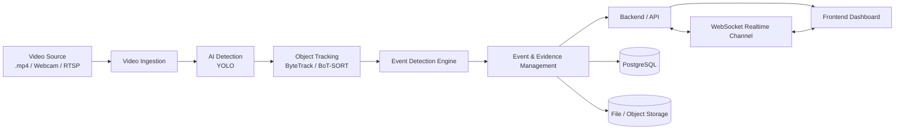

# VisionGuard Architecture

## Design Goals

- Use one shared pipeline for all video sources.
- Keep the MVP as a modular monolith.
- Store metadata in PostgreSQL and evidence in file or object storage.
- Support realtime monitoring and event delivery.
- Keep the design testable with local `.mp4` files before camera deployment.

## High-Level Flow

## Module Responsibilities

### Video Input / Camera

Owns source configuration, lifecycle state, and source type abstraction for local files, webcams, and RTSP cameras.

### Video Ingestion

Normalizes frames from all source types into a common frame stream so the rest of the system does not care where the frame originated.

### AI Detection

Runs object detection on each frame and emits bounding boxes, class labels, and confidence values.

### Object Tracking

Assigns stable track IDs across frames so events can be based on object movement, not just isolated detections.

### Event Detection Engine

Evaluates intrusion, line crossing, and loitering rules from tracked objects and configured zones or lines.

### Event & Evidence Management

Creates event records, stores evidence references, and manages snapshot or clip metadata.

### Backend / API

Exposes camera management, event history, evidence lookup, and analytics endpoints.

### Frontend

Provides live monitoring, event review, and operational visibility for cameras and locations.

### PostgreSQL

Stores metadata for locations, cameras, zones, events, and evidence references.

### File / Object Storage

Stores snapshot images and video clips referenced by event records.

### Realtime Communication

Uses WebSocket for event push, camera status updates, and live monitoring updates.

## Data Flow

1. A source adapter opens a `.mp4`, webcam, or RTSP input.
2. Frames are normalized by the ingestion layer.
3. YOLO runs detection on each frame.
4. The tracker assigns persistent track IDs.
5. The event engine checks the track against zone and line rules.
6. When a rule fires, the evidence manager stores metadata and file references.
7. The backend persists only the necessary metadata in PostgreSQL.
8. The backend pushes realtime updates to the frontend through WebSocket.

## Why One Shared Pipeline

A single pipeline makes offline testing and production deployment behave the same way. The same detection, tracking, and event logic can be validated using a local `.mp4` file, then reused unchanged for webcam and RTSP cameras. That reduces duplicate code, keeps behavior consistent across sources, and makes future source types easier to add.

## Domain Model Summary

- Location groups cameras by physical area.
- Camera / VideoSource stores source configuration and operational state.
- Zone stores restricted areas and monitored regions.
- Event stores generated security incidents and references to evidence.
- Recording stores snapshot or clip metadata.

## Architectural Choice

VisionGuard should start as a modular monolith rather than microservices. That keeps deployment simpler, avoids premature distribution overhead, and still allows clear internal boundaries between camera ingestion, AI, events, storage, and API layers.

## Phase 02 Boundaries

- Define API contracts for camera, event, and evidence operations.
- Specify queueing or buffering strategy if live load demands it.
- Add persistence schemas for metadata entities.
- Implement the shared frame pipeline.
- Add dashboard views and realtime event panels.
